# SPINS: Sparsely-Supervised Human Novel View Synthesis from a Single Image

Sparse-view supervision for feed-forward human 3D Gaussian reconstruction.

<p align="center">
  <a href="assets/figures/SPINS_teaser.pdf">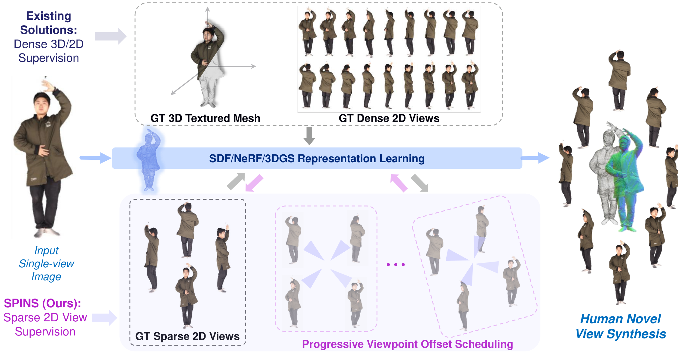</a>
</p>

<details>
<summary>Abstract</summary>

Existing human novel view synthesis (NVS) methods typically rely on textured 3D scans, dense pose-aligned multiview images, or parametric body priors such as SMPL, making their training data costly to acquire and difficult to scale beyond controlled capture settings.
We present **SPINS**, a framework for single-image human NVS that learns feed-forward human 3D Gaussian Splatting (3DGS) from sparse 2D view supervision.
Given a single input image, a human-specific multiview diffusion module first synthesizes a small set of anatomically plausible canonical views.
An object-centric 3DGS reconstruction model, initialized from large-scale pretraining, is then adapted with only sparse 2D human views to convert the synthesized views into a 3DGS representation.
We introduce a sparsely supervised perturb-and-reconstruct objective: Gaussians predicted from the synthesized views are rendered at offset viewpoints, and the reconstruction obtained from those renderings must reproduce the original views.
Geometric errors that are invisible from the supervised views become visible once the asset is rendered from elsewhere, and the round trip converts them into reconstruction error that the model is driven to correct.
The objective, therefore, enforces stable geometry and appearance across viewpoints with nothing beyond the sparse 2D views as supervision.
Trained once on four views per subject of a single dataset, SPINS remains competitive with densely supervised methods across three benchmarks despite using no dense multiview, textured-mesh, or SMPL supervision, and is markedly more resilient to partial occlusions of the input view.
These results show that single-image human 3DGS can be learned without dense multiview capture, textured meshes, or explicit parametric body priors.

</details>

## Method

<p align="center">
  <a href="assets/figures/SPINS_pipeline.pdf">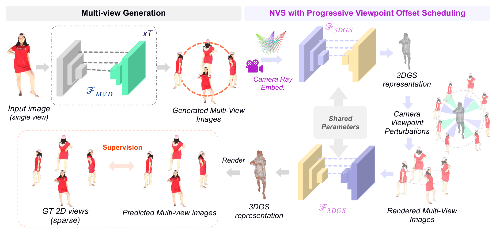</a>
</p>

<details>
<summary>Implementation note</summary>

This is an approximate implementation of the paper. Paper-specific code and checkpoints will be made available soon. This release covers LGM adaptation from four calibrated human views and an experimental MV-Adapter LoRA trainer for single-image multiview generation.

</details>

## Qualitative results

### THuman2.0

<table>
  <tr>
    <td align="center" width="50%"></td>
    <td align="center" width="50%"></td>
  </tr>
  <tr>
    <td align="center" width="50%"></td>
    <td align="center" width="50%"></td>
  </tr>
  <tr>
    <td align="center" width="50%"></td>
    <td align="center" width="50%"></td>
  </tr>
  <tr>
    <td align="center" width="50%"></td>
    <td align="center" width="50%"></td>
  </tr>
</table>

### Renderpeople

Selected zero-shot reconstructions from rendered scans.

<table>
  <tr>
    <td align="center" width="33%">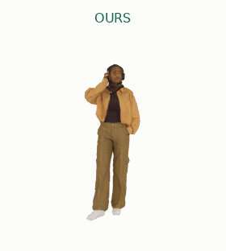</td>
    <td align="center" width="33%">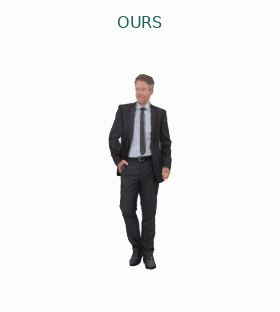</td>
    <td align="center" width="33%"></td>
  </tr>
</table>

### HuMMan

Selected zero-shot reconstructions from rendered train- and test-split scans.

<table>
  <tr>
    <td align="center" width="33%">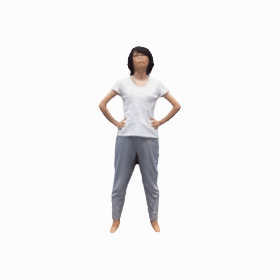</td>
    <td align="center" width="33%">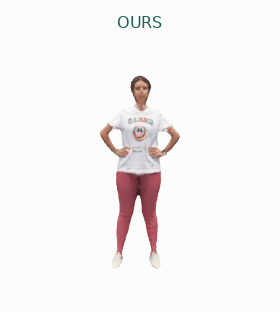</td>
    <td align="center" width="33%">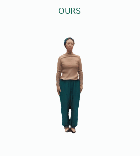</td>
  </tr>
  <tr>
    <td align="center" width="33%">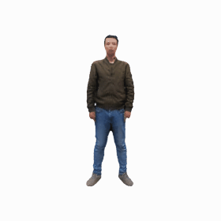</td>
    <td align="center" width="33%">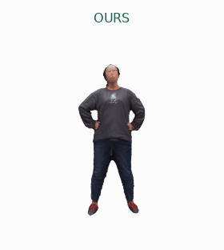</td>
    <td align="center" width="33%">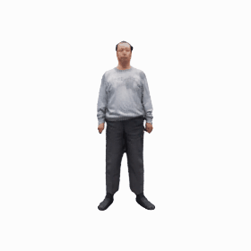</td>
  </tr>
  <tr>
    <td align="center" width="33%">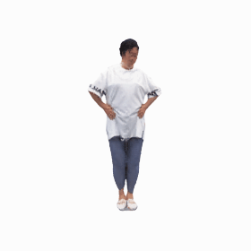</td>
    <td align="center" width="33%">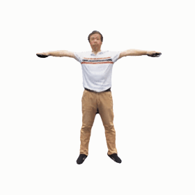</td>
    <td align="center" width="33%">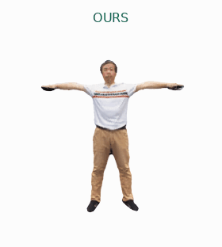</td>
  </tr>
</table>

## Setup, data, and training

### Install

Requires Linux, Python 3.10, an NVIDIA GPU with BF16 support, CUDA toolkit 12.1 (`nvcc`), and a C++ compiler. Training uses one GPU.

```bash
git clone https://github.com/arid29/SPINS.git
cd SPINS
conda create -n spins python=3.10 -y
conda activate spins
python -m pip install --upgrade pip setuptools wheel
python -m pip install torch==2.5.1 torchvision==0.20.1 --index-url https://download.pytorch.org/whl/cu121
python -m pip install --no-deps xformers==0.0.29.post1
python -m pip install -r requirements.txt
bash scripts/install_rasterizer.sh
python scripts/prepare_weights.py --download-public
```

The weight helper downloads the public LGM initialization and VGG/LPIPS weights. Set `CUDA_HOME` if the rasterizer build cannot locate your toolkit.

### THuman2.0 data

Request scans through the [official THuman download instructions](https://github.com/ytrock/THuman2.0-Dataset#download-instructions). Keep each OBJ, MTL, and its textures together as `/path/to/THuman2.0/0000/0000.obj`, through `0525/0525.obj`. Raw data and checkpoints are not distributed here.

**Training: 0000–0499. Evaluation: 0500–0525.** Check that your download includes these IDs.

For preprocessing, install the rendering dependencies and ensure NVIDIA EGL/OpenGL and `libegl1`, `libgl1`, `libglu1-mesa` are available:

```bash
python -m pip install -r requirements-render.txt
python scripts/preprocess_thuman.py \
  --mesh-root /path/to/THuman2.0 \
  --output THumanDataset/thuman2_rendered_lgm --start 0 --end 525
python scripts/validate_data.py --data-root THumanDataset/thuman2_rendered_lgm
```

The renderer produces 12 views, masks, and cameras per scan; training uses views 00, 03, 06, and 09. Defaults match the loader's 49.1° field of view. Inspect a single subject first with `--start 0 --end 0` and a temporary output directory. Existing rendered data can be used after validation.

### Train and evaluate

```bash
bash scripts/run.sh progressive \
  --workspace workspace_progressive --epochs 60 --epochs-per-stage 3 \
  --data-root THumanDataset/thuman2_rendered_lgm

bash scripts/run.sh evaluate \
  --checkpoint workspace_progressive/best.safetensors \
  --data-root THumanDataset/thuman2_rendered_lgm --workspace workspace_eval
```

Training uses four-view cycle consistency with RGB, mask, and LPIPS losses; the viewpoint-offset cap grows from 5° to 90°. Add `--resume` with the original training arguments to resume a completed epoch. Evaluation requires four calibrated views and saves comparison images and metrics.

### Single-image multiview LoRA

Install from the PyTorch environment above, then train:

```bash
bash scripts/setup_multiview.sh
.venv-mvadapter/bin/python train_multiview_lora.py \
  --data-root /path/to/thuman2_rendered_lgm \
  --workspace workspace_multiview_lora --steps 3000 --rank 32

.venv-mvadapter/bin/python infer_multiview.py \
  --adapter workspace_multiview_lora/step_003000 \
  --data-root /path/to/thuman2_rendered_lgm \
  --subject 500 --source 2 --output workspace_multiview_result
```

Each of the 12 views can condition three targets at offsets `+3, +6, +9` modulo 12: `02 → 05, 08, 11`. Training uses subjects 0000–0499; evaluation uses 0500–0525. The trainer adds rank-32 attention LoRAs to SDXL + MV-Adapter at its native 768-pixel resolution. Half the conditioning images receive synthetic occlusion covering 10–35% of the foreground; targets stay clean. Set `--occlusion-prob 0` to disable augmentation. The model adapts to the existing fixed perspective cameras and preserves the full image framing.

Checkpoints and clean/occluded previews are saved every 500 steps. Resume with `--resume workspace_multiview_lora/step_001000` and the original training arguments. For your own preframed square image, replace the inference data arguments with `--image input.png`; it should match the training framing. Outputs contain the input and three generated views. Dataset inference also saves cameras and a target comparison.

## Acknowledgments

Built on [LGM](https://github.com/3DTopia/LGM). Data: [THuman2.0](https://github.com/ytrock/THuman2.0-Dataset), [Renderpeople](https://renderpeople.com/free-3d-people/), and [HuMMan](https://huggingface.co/datasets/caizhongang/HuMMan). Renderpeople and HuMMan examples use the existing checkpoints for external inference only. See [THIRD_PARTY.md](THIRD_PARTY.md) and [LICENSE](LICENSE) for dependencies and licensing.

The multiview trainer uses [MV-Adapter](https://github.com/huanngzh/MV-Adapter), [SDXL](https://huggingface.co/stabilityai/stable-diffusion-xl-base-1.0), and the [SDXL VAE fix](https://huggingface.co/madebyollin/sdxl-vae-fp16-fix).
